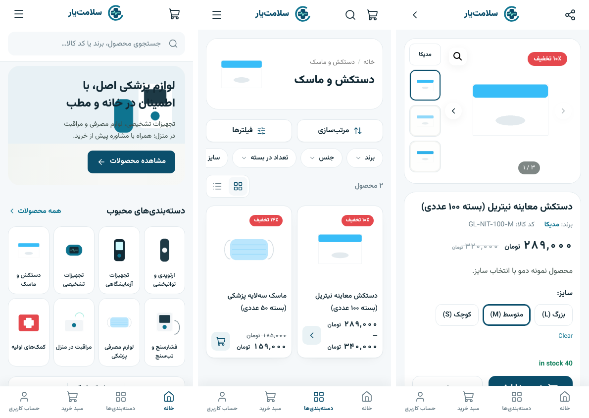

# دموها: یک قالب، چند نوع فروشگاه

قالب و افزونه همراه حالا دو دموی آماده دارند. هر دو از همان کد، همان ویجت‌ها و همان صفحات WooCommerce استفاده می‌کنند؛ فقط ظاهر و ساختار فروشگاه عوض می‌شود.

| | دمو ۱ — تجهیزات الکتریکی | دمو ۲ — تجهیزات و لوازم پزشکی |
|---|---|---|
| رنگ اصلی / برند / تأکیدی | `#064E3B` / `#075E46` / `#C7F52A` | `#0B4F6C` / `#0E7490` / `#7DE2D1` |
| نماد لوگوی پیش‌فرض | صاعقه | صلیب پزشکی با خط نوار قلب |
| آیکون‌های جایگزین | صاعقه، لامپ | ضربان قلب، گوشی پزشکی |
| دسته‌ها | کلید و پریز، روشنایی، سیم و کابل، … | تجهیزات تشخیصی، فشارسنج و تب‌سنج، لوازم مصرفی پزشکی، دستکش و ماسک، مراقبت در منزل، ارتوپدی و توانبخشی، تجهیزات آزمایشگاهی، کمک‌های اولیه |
| ویژگی‌ها (برای فیلتر و مشخصات فنی) | رنگ، مدل، نوع نصب، جنس بدنه، جریان نامی، ولتاژ، توان، سری، IP | مدل، سایز، جنس، تعداد در بسته، کاربری، منبع تغذیه، استریل، کشور سازنده، کد IRC |
| دکمه خرید عمده | خرید عمده | خرید سازمانی |

## اعمال دمو

**ووکامرس ← تنظیمات صمدی ← ابزارهای راه‌اندازی ← اعمال دمو (نوع فروشگاه)**: دمو را انتخاب کنید و «اجرا» را بزنید. گزینه‌ها:

- ساخت ویژگی‌ها و دسته‌بندی‌های همان دمو (موارد موجود دوباره ساخته نمی‌شوند)
- ساخت صفحه اصلی Elementor با متن بنر و مزایای همان دمو
- تنظیم به‌عنوان صفحه اصلی سایت

رنگ‌ها، نوع فروشگاه، متن بنر، مزایا و برچسب‌ها در سفارشی‌ساز ذخیره می‌شوند و رنگ/فونت سراسری Elementor هم هم‌زمان به‌روز می‌شود. بعد از آن همه چیز مثل قبل از سفارشی‌ساز و Elementor قابل تغییر است. «نوع فروشگاه» به‌تنهایی هم در «سفارشی‌سازی ← تایپوگرافی» قابل تغییر است.

دموی جدید را می‌توان با فیلتر `samadi_demos` از یک افزونه اضافه کرد.

## آنچه دمو نمی‌سازد

محصول، قیمت، موجودی، برند، مجوز (IRC / سازمان غذا و دارو)، نماد اعتماد یا اطلاعات تماس ساخته نمی‌شود. محصولات و تصاویری که در تصاویر بالا دیده می‌شوند فقط داده‌های سایت تست بودند.

## نکات مخصوص فروشگاه پزشکی

- فیلد «کد IRC» را فقط با کد واقعی هر کالا پر کنید؛ در جدول مشخصات و فیلتر نمایش داده می‌شود.
- برای کالاهایی که فروش آن‌ها نیازمند نسخه یا شرایط خاص است، از گزینه «قیمت با استعلام» استفاده کنید تا مستقیم به سبد افزوده نشوند.
- ادعای درمانی/پزشکی در توضیح محصولات را طبق ضوابط سازمان غذا و دارو بنویسید.

## تست دمو ۲

نصب تازه WordPress 7.1.3 + WooCommerce 10.9.4 + Elementor 3.35.9 (ساخته‌شده از سورس)، اعمال دمو با همین ابزار، ۱۰ محصول نمونه (ساده، متغیر بر اساس سایز، تخفیف‌دار، ناموجود، قیمت با استعلام):

- صفحه اصلی Elementor، دسته و محصول در عرض‌های ۳۷۵ تا ۱۹۲۰: بدون اسکرول افقی و بدون خطای JavaScript.
- انتخاب سایز ← قیمت اصلی به‌روز شد (۲۸۹٬۰۰۰ برای سایز M).
- چیپ‌های فیلتر سریع فقط ویژگی‌های همان دسته را نشان دادند (برند، جنس، تعداد در بسته، سایز).
- دمو ۱ پس از این تغییرات دوباره تست شد و سالم است.
